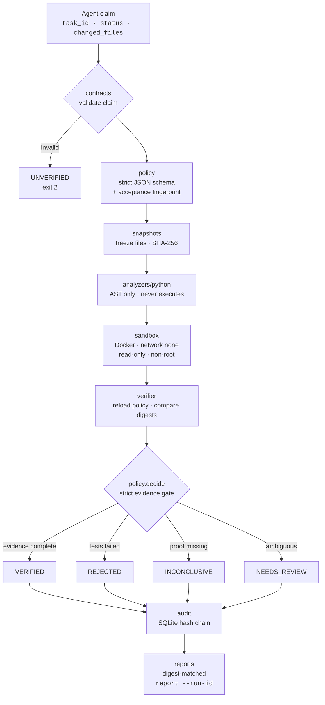
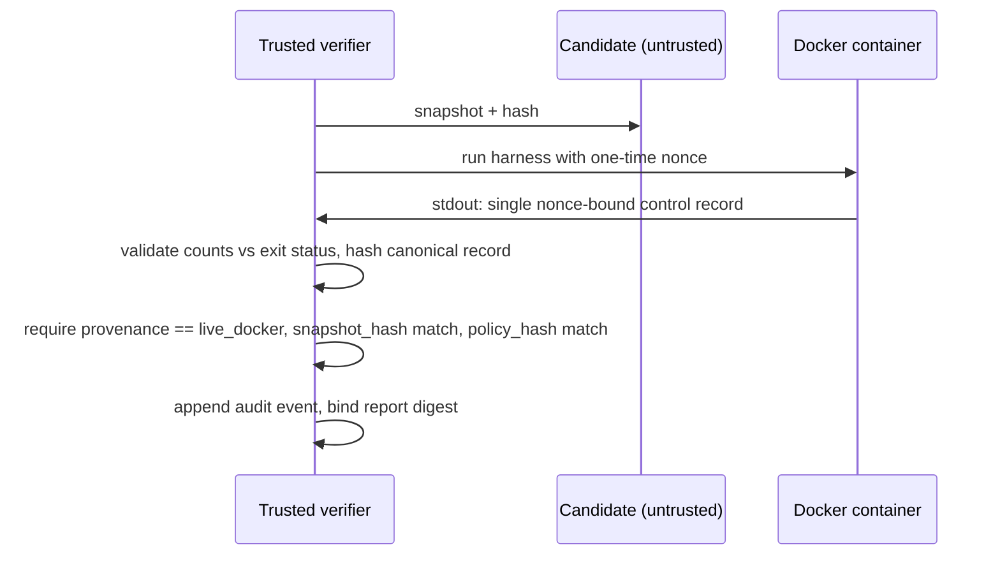

# VerifyGate

**An agent saying "done" is a claim. VerifyGate turns it into evidence — or refuses.**

<p>
  
  
  
  
  
</p>

VerifyGate is an **independent verification gate** for AI agent work. The agent submits a completion claim plus a candidate directory. VerifyGate freezes that candidate, binds it to an administrator-controlled policy, runs mandatory checks inside a disposable Docker container, and records a hash-linked decision.

`VERIFIED` means one thing only: *the configured checks passed on that exact artifact under that exact policy*. Nothing else.

> Engineering MVP. Not a hostile-code sandbox, not a bypass-proof merger, and not a substitute for human review.

---

## Why it exists

Agents are optimistic. They report tests they did not run, files they did not touch, and passes they did not earn. A `tests_run: [...]` field in a claim is a **statement**, not proof.

VerifyGate inverts the trust: the claim is an *input to a check*, never the result.

| Trust the agent says | VerifyGate instead |
|---|---|
| "Tests pass" | Runs a trusted, read-only acceptance suite outside the candidate's reach |
| "Only `calculator.py` changed" | Snapshots the directory and hashes every included file |
| "I followed the policy" | Reloads the policy and compares digests, including the acceptance-suite fingerprint |
| "Here is the report" | Re-derives the report digest and matches it to the audit event |
| "Trust me" | Exits non-zero |

---

## The pipeline



Every arrow is a separate module with its own failure mode. No stage is allowed to assume the previous one told the truth.

---

## Evidence integrity

The hard part is not running tests. It is knowing the evidence was not forged.



- **No writable results mount.** Removed by design: a mounted report file let a fake executor write `tests_run=999, failures=0` and return "passed".
- **Nonce-bound control record.** Duplicate, malformed, or extra records fail closed.
- **Provenance gate.** `trusted_harness_stdout` required; mocked results can never present as live evidence.
- **Independent acceptance suite.** `acceptance/` lives outside candidate fixtures, is fingerprinted into the policy hash, and is mounted read-only.
- **Digest-matched reports.** A stored report that does not match its audit event is rejected on read.

Candidate tests are still untrusted. They share a process with the harness and can see the nonce. This is raised evidence, not cryptographic proof — see [docs/limitations.md](docs/limitations.md).

---

## Quick start (clean Linux)

Requires **Python 3.12.7**, GNU Make, Docker Engine, and Docker access for the **trusted verifier process only** — never for candidate jobs.

```sh
make test                                    # offline suite, no Docker, no network
docker build -t verifygate:local .           # trusted image
mkdir -p .verifygate
```

> Docker is unavailable on the machine this project was developed on, so the image build and live sandbox runs are **unexecuted**. Offline tests are green; live acceptance is pending. Do not read the demo output as a product verdict.

### Demo

```sh
PYTHONPATH=src python -m verifygate.cli version
PYTHONPATH=src python -m verifygate.cli policy-validate --candidate examples/passing --policy policies/python.json
PYTHONPATH=src python -m verifygate.cli demo --ledger .verifygate/audit.sqlite --output-dir .verifygate
PYTHONPATH=src python -m verifygate.cli status --ledger .verifygate/audit.sqlite
PYTHONPATH=src python -m verifygate.cli audit-verify --ledger .verifygate/audit.sqlite
```

`demo` invokes the real Docker runner for the broken then passing fixture. It never substitutes fake evidence. Without Docker both runs are `INCONCLUSIVE` and the command exits `1`. With `verifygate:local` built, the intended outcome is broken `REJECTED`, passing `VERIFIED`.

### Verify one candidate

```sh
PYTHONPATH=src python -m verifygate.cli verify \
  --candidate examples/broken --claim examples/claim.json \
  --policy policies/python.json --ledger .verifygate/audit.sqlite \
  --report .verifygate/broken.report.json
```

---

## CLI

| Command | What it does |
|---|---|
| `version` | Print tool and policy format version |
| `policy-validate` | Validate a policy against the strict schema; print its digest |
| `verify` | Verify one candidate/claim pair, write report + audit event |
| `demo` | Run broken then passing fixture through the real Docker runner |
| `status` | List recent runs from the validated audit chain |
| `report --run-id ID` | Read a stored report only if its digest matches the audit event |
| `audit-verify` | Verify the SQLite hash chain |

**Exit codes:** `0` = `VERIFIED` · `1` = `REJECTED`, `INCONCLUSIVE`, or `NEEDS_REVIEW` · `2` = invalid input or failed report storage (`UNVERIFIED`).

---

## Verdicts

| Verdict | Meaning |
|---|---|
| `VERIFIED` | Every mandatory check passed with matching snapshot, policy, provenance, and report digests |
| `REJECTED` | A check ran and failed |
| `INCONCLUSIVE` | Evidence is incomplete, missing, stale, or provenance is wrong |
| `NEEDS_REVIEW` | Ambiguous evidence that fails closed to a human |
| `UNVERIFIED` | Input never reached verification (bad claim, bad policy, storage failure) |

Defaults to refusal. Absence of proof is never success.

---

## Policy (administrator-owned)

[policies/python.json](policies/python.json) pins the image, allowed task IDs, exclusions, resource limits, and the mandatory checks.

```json
{
  "version": 1,
  "image": "verifygate:local",
  "task_ids": ["VG-DEMO"],
  "language": "python",
  "stub_mode": "warn",
  "exclusions": [".git", ".venv", "__pycache__", ".env"],
  "timeout": 120,
  "memory": 512,
  "cpus": 1,
  "acceptance": {
    "required": true,
    "suite_id": "calculator",
    "version": "1",
    "path": "../acceptance",
    "container_path": "/opt/app/acceptance",
    "minimum_tests": 1
  },
  "checks": [
    { "id": "syntax", "command": "python -I /opt/app/src/verifygate/syntax_check.py" },
    { "id": "unit-tests" },
    { "id": "acceptance" }
  ]
}
```

Current policy digest: `6780c9ce4463d0307b0797c8703c8f4f66f28f453d2c136c978fabd842abea70`.

The image tag is mutable and administrator-controlled. Use a trusted build and protected CI, never an agent-supplied image.

---

## Sandbox hardening

Flags applied by [sandbox.py](src/verifygate/sandbox.py):

| Control | Value |
|---|---|
| Network | `--network none` |
| Filesystem | `--read-only` root, `--tmpfs /tmp` |
| Capabilities | `--cap-drop ALL` |
| Privilege escalation | `--security-opt no-new-privileges` |
| User | `--user 65534:65534` |
| Limits | `--pids-limit 128`, memory and CPU from policy |
| Candidate mount | `snapshot → /workspace:ro` |
| Acceptance mount | `acceptance → /opt/app/acceptance:ro` |

Docker is **not** a hostile-code security boundary. Treat a container escape as a real risk and keep untrusted code off privileged daemons.

---

## MCP integration

Six tools over stdio: `submit_completion_claim`, `request_verification`, `get_status`, `get_report`, `list_runs`, `check_audit_integrity`.

```sh
uv sync --frozen --extra mcp --no-dev
export VERIFYGATE_CANDIDATE=... VERIFYGATE_CLAIM=...
export VERIFYGATE_POLICY=...  VERIFYGATE_LEDGER=...  VERIFYGATE_REPORT=...
uv run --frozen --offline verifygate-mcp
```

Paths must live **outside candidate control**. MCP cannot block other agent tools; it can only refuse to certify what it did not observe.

### Git hook and CI

- [hooks/pre-commit](hooks/pre-commit) — opt-in, fail-closed sample. Exits non-zero on rejected/inconclusive. Git hooks are bypassable with `--no-verify`; never the only boundary.
- [scripts/ci-gate.sh](scripts/ci-gate.sh) — CI wrapper. Load policy and image from protected sources, then require the check on the branch.

Nothing installs automatically. No branch protection or cloud CI is configured here.

---

## Project layout

```
src/verifygate/
├── contracts.py      claim validation
├── policy.py         strict schema, digest, verdict rules
├── snapshots.py      file freeze + manifest hashing
├── analyzers/        Python AST checks (no execution)
├── sandbox.py        Docker runner + nonce protocol
├── test_harness.py   in-container harness
├── verifier.py       orchestration + integrity re-checks
├── audit.py          SQLite hash chain
├── reports.py        digest-bound report storage
├── cli.py            command line
└── mcp_server.py     stdio MCP server
acceptance/           trusted test suite (outside candidate)
examples/             passing and broken fixtures
tests/                48 tests, 2 explicit Docker skips
docs/                 architecture, threat model, limits
```

---

## Tests

```sh
make test
# or on Windows / without Make:
PYTHONPATH=src python -m unittest discover -s tests -v
```

**48 tests, 2 explicit skips** (real-Docker tests gated by `VERIFYGATE_RUN_REAL_DOCKER=1`). Coverage includes claim/task/path rejection, symlink exclusion, frozen-hash mismatch, policy mutation, missing evidence, zero tests, malformed and duplicate nonce records, bounded log capture, Docker argv construction, absence of a results mount, provenance gating, acceptance fingerprinting, candidate-test independence, audit tamper, and report tamper.

Negative cases are first-class here; see [docs/testing.md](docs/testing.md).

---

## Honest limits

- **Live Docker acceptance is unverified.** No Docker on the development host; the image build and sandbox runs have not executed.
- Candidate tests remain untrusted and in-process with the harness. The nonce is visible; extra control bytes fail closed, but this is not proof.
- The acceptance suite proves behavior it asserts — not semantic correctness of the whole program.
- Python AST checks find syntax and obvious stubs, not type or reference errors.
- A local SQLite chain detects retained-row tampering and reordering, not truncation of its tail without external anchoring.
- Retained command output can contain secrets. Use test credentials and restrict report access.
- The Docker image tag is mutable; supply-chain trust is your responsibility.

Read [docs/limitations.md](docs/limitations.md), [docs/security.md](docs/security.md), and [docs/threat-model.md](docs/threat-model.md) before relying on any result.

---

## Documentation

| Doc | Contents |
|---|---|
| [architecture.md](docs/architecture.md) | Module boundaries and data flow |
| [threat-model.md](docs/threat-model.md) | Adversaries and trust boundaries |
| [security.md](docs/security.md) | Controls and residual risk |
| [testing.md](docs/testing.md) | Test matrix and negative cases |
| [limitations.md](docs/limitations.md) | Known gaps |
| [demo-guide.md](docs/demo-guide.md) | Walkthrough |
| [traceability.md](docs/traceability.md) | Requirement to test mapping |
| [PROJECT_STATUS.md](PROJECT_STATUS.md) | Authoritative status |

---

**Default posture: refuse.** A gate that can be talked into saying yes is not a gate.
